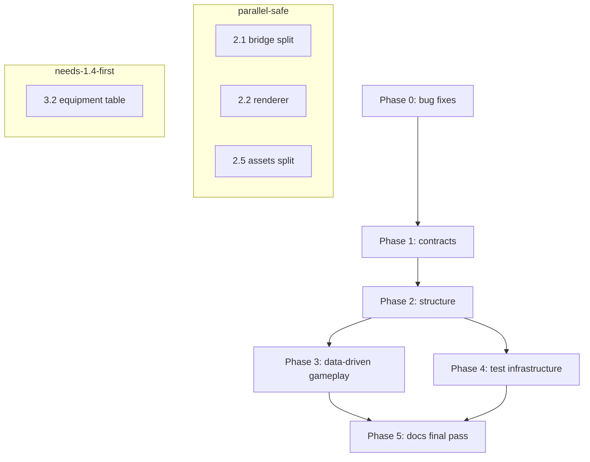

# Conquer Ops — Refactoring Plan

Audience: AI agents executing refactors. Each task is self-contained: goal, concrete steps,
files touched, verification. Read [CONTRACT.md](CONTRACT.md) first; it defines engine ↔ Rust
ownership and must be kept in sync with any change that crosses the boundary.

## Ground rules (apply to every task)

1. **Determinism is sacred.** Everything reachable from `zhbo_logic_*` runs inside Zero Hour's
   lockstep simulation. No wall-clock time, no unseeded randomness, no `HashMap` iteration order
   affecting outcomes, no reading environment variables after init except through the loadout
   path already documented (`ZHBO_LOADOUT`, which every player must set identically).
   Client-side code (`zhbo_client_*`, `client.rs`, `hud.rs`, `viewmodel.rs`) is exempt.
2. **The ABI is a contract.** `host/zhbo/zhbo_core.h` and `crates/zhbo-core/src/{ffi,host}.rs`
   assert struct sizes on both sides. Any layout change bumps `ZHBO_ABI_VERSION` in both places.
3. **Don't modify `host/GeneralsGameCode`** (the submodule). Engine changes go in
   `host/patches/*.patch`.
4. **Never weaken the asset rule:** nothing from either game is shipped; converted data stays
   local. Do not commit `*.big`, `*.ff`, `*.sabs`, `*.sabl`, `*.ipak`.
5. **Validate with the smallest covering command, then widen:**
   `cargo test -p <crate>` → `cargo test --workspace` → in-game `scripts/autotest.ps1` /
   `scripts/inputtest.ps1` (Windows). State what passed in the task result.
6. Prefer surgical edits. Do not reformat files you are not otherwise changing.

---

## Phase 0 — Correctness fixes (no behavior change intended except the fix itself)

Small, independently landable bug fixes found during the audit. Each is its own commit.

### 0.1 Renderer correctness (zhbo-gfx)

| # | Bug | Where | Fix |
|---|---|---|---|
| a | Transient index/vertex buffers passed with count `u32::MAX` ("all remaining", legal in bgfx) compute a garbage count and the draw is always dropped | `runtime/mod.rs` `set_index_buffer`/`set_vertex_buffer` (`num == u32::MAX` path); skip happens in `frame.rs` `encode_draw` | For transient sources, compute `num` from the arena bytes actually available: `(arena_end - start) / elem_size`, and clamp in `encode_draw` like the vertex path's `fits` |
| b | `Arena::alloc` integer overflow: `start + num*stride` with hostile `u32` inputs overflows in debug (panic) and wraps in release (wild pointer) | `runtime/mod.rs` `Arena::alloc` | Use `checked_mul`/`checked_add`; return `None` on overflow. Add a unit test with `num = stride = u32::MAX` |
| c | Resource-pool handles are plain indices → ABA: destroy + recreate reuses a slot; a stale handle then operates on the new resource | `runtime/mod.rs` `Pool` | Add a 16-bit generation to handles (pack generation into the high bits; update `zhbo_gfx.h` handle docs). `get`/`get_mut` compare generations. Bump any format that persists handles |
| d | `backbuffer.unwrap()` is an invariant by call ordering, not by type | `runtime/frame.rs` (~464, ~503) | Make `ensure_backbuffer` return `Result<&Backbuffer, _>` and propagate, or store `backbuffer: Backbuffer` (non-Option, created in `new`) |
| e | `blit` clamps depth to ≥1 even when the source layer range is empty → wgpu validation error, blit silently lost; zero-size copies not skipped | `runtime/mod.rs` `blit` (~1497) | Skip the blit (with one `report()` line) when the clamped extent or layer range is empty |
| f | `Pool::insert` returns `INVALID` silently when full; `create_shader` failure surfaces only later as pipeline failure | `runtime/mod.rs` | `report()` on pool exhaustion; make `create_shader` return `INVALID` on module-creation failure (pipeline errors then name the real cause) |
| g | `write_region` short-data case logs once and drops the upload (texture stays black) | `runtime/mod.rs` `write_region` | Log with the texture serial and expected/actual sizes; keep the drop but make it loud |

Verification: `cargo test -p zhbo-gfx` (add tests for a, b, c), then the headless frame test
(`tests/headless.rs`) still passes with `stats().errors == 0`.

### 0.2 C++ bridge fixes (host/zhbo)

| # | Bug | Where | Fix |
|---|---|---|---|
| a | `cbExtent` dereferences `TheTerrainLogic` with no null check (neighbors check) | ZhboBridge.cpp (~142) | Null-check like `cbGroundHeight`; return the map-less fallback extents |
| b | Text shadow color bit-bleed: `(argb & 0xFF000000) >> 1 & 0xFF000000` leaks alpha bit 0 into red for odd alpha values | ZhboBridge.cpp `cbText` (~770) | Compute alpha separately: `UnsignedInt a = (argb >> 24) >> 1; shadow = (a << 24)` |
| c | General-name prefix checked two ways: `"ZHBO_General_"` (13) in `isGeneral` vs `"ZHBO_General"` (12) in `Zhbo_OnTakeControlMessage` | ZhboBridge.cpp (~375, ~2204) | Route both through `isGeneral` |
| d | `cbImage` caches `const Image*` in a static map across game resets; `TheMappedImageCollection` resets per game → dangling pointers | ZhboBridge.cpp (~788) | Clear `s_images` in `Zhbo_Reset` |
| e | Autopilot step machines use function-local statics (`s_step`, `s_done`) that `Zhbo_Reset` cannot clear → scripted tests never fire again in the same process | ZhboBridge.cpp (~1166, ~1400) | Move these into the `Autopilot` struct (memset in `Zhbo_Reset`) |
| f | `ZhboRtsWeapons ammo;` read uninitialized on three call sites if the Rust call early-returns | ZhboBridge.cpp (~478, ~557, ~2582) | Zero-initialize: `ZhboRtsWeapons ammo = {};` |
| g | `ZhboViewmodel.cpp` has no reset: `s_model`/`s_missing`/`s_notes*` survive game reset while the 3D scene is torn down | ZhboViewmodel.cpp + ZhboBridge.cpp `Zhbo_Reset` | Add `ZhboViewmodel_Reset()` (calls the file-local `release`, clears the caches); call it from `Zhbo_Reset` |
| h | `cbDisable` casts unclamped `seconds * 30` to `UnsignedInt` (float→int overflow is UB) | ZhboBridge.cpp (~356) | Clamp `seconds` to a sane max (e.g. 3600) before the cast |
| i | `cbClientCanPlace` static `s_last` cache is keyed on nothing and survives reset | ZhboBridge.cpp (~2041) | Key the cache on `(tmpl, pos.x, pos.y, pos.z, angle)`; clear in `Zhbo_Reset` |
| j | `utf8()` encodes UTF-16 surrogates as two invalid 3-byte UTF-8 sequences | ZhboBridge.cpp (~1746) | Detect high/low surrogate pairs and emit the combined code point; emit `?` for lone surrogates |
| k | `s_wheelAccum`, `s_lastTick`, `s_rtsHitFx*`, `s_lastLog`, `s_reported` not reset in `Zhbo_Reset` | ZhboBridge.cpp | Reset them (audit the full global inventory; every per-game static belongs to `Zhbo_Reset` or a named `ResetX()`) |

Verification: builds (`cargo xtask build`), then `scripts/autotest.ps1` 7/7 on the DX8 build.
Run an autopilot test twice in one process to prove (e).

### 0.3 Format-reader hardening (zhbo-formats)

| # | Bug | Where | Fix |
|---|---|---|---|
| a | `.big` reader pre-allocates `Vec::with_capacity(count)` with a file-controlled count before validating | big.rs (~71) | Validate `count * 8 <= data_start - 16` first; cap `with_capacity` |
| b | `.ipak` block walk never checks `payload_len` against the entry's declared end; corrupt block sizes read into the next entry; per-command `vec![0u8; size]` is an unbounded allocation | ipak.rs (~90-113) | Track remaining entry bytes; error `FormatError::Corrupt` when a command overruns; cap command size |
| c | `.sabs` entry-table `entry_size * count` unchecked and unbounded | sab.rs (~100) | Check `entry_size >= 20`, cap `count` (e.g. `1 << 20`), use checked multiplication |
| d | `xanim` checkpoint-skip formula `(count - 2)/256 + 2` disagrees with OAT's `(count - 1)/256 + 1` for counts in [65, 256] → over-skips one dataShort | xanim.rs (~120) | Cross-check against OAT's `ReadPackedIndices`; fix the formula; add a unit test with a synthetic long anim |
| e | `xmodel` blended-vertex bone0 units (byte offset vs index — dividing by `SKEL_MAT_SIZE` twice) suspect vs OAT | xmodel.rs (~270-285) | Cross-check against OAT's `XModelSurfs` blend-vert reader; correct if needed; extend the (currently ignored) MP character test to catch it |
| f | `Zone` accessors return 0/empty on bad addresses, so asset readers can't tell "field is 0" from "pointer corrupt" | t6zone/mod.rs (~443-470) | Add `try_u32`/`try_bytes`-style fallible accessors; use them at asset boundaries (top-level structs), keep the lenient ones for inner fields |

Verification: `cargo test -p zhbo-formats`; the `zhbo-assets walk` zone-conformance check (every
zone in `zone/all` loads with 0 bytes left over) still passes on a machine with BO2 installed.

### 0.4 Small Rust fixes (zhbo-core, requirements, xtask)

- **zhbo-requirements `reg::read_string`**: drops the last character when a `REG_SZ` isn't
  NUL-terminated (size/2 - 1 unconditionally). Trim at the first NUL instead of assuming one.
- **xtask `copy_dir_if_changed`**: never deletes files removed from the source → stale glue
  files accumulate in the engine work tree. Delete extras on the destination side.
- **xtask FFmpeg**: downloads a rolling "latest" URL (non-reproducible). Pin a dated release.
- **xtask unzip via `tar -xf`**: GNU tar can't read zips. Use `unzip` with a `tar` fallback
  (or a pure-Rust zip crate).
- **zhbo-core `weapons.rs::toggle_alt`**: verify against BO2 — without Fast Hands the alt-mode
  raise is `max(quick_raise_time, raise_time * 0.5)`; with Fast Hands it is `quick_raise_time`.
  If BO2 always halves the raise for alt toggles, simplify; if BO2 uses the full raise without
  Fast Hands, fix. Cite the source in a comment either way.
- **`hud.rs` / `client.rs` `map_open`**: audit that HUD visibility reads the same frame's value
  (set at client.rs:647, read at hud.rs:106). No defect observed; add a regression test only.

---

## Phase 1 — Contracts and shared registries

These tasks create the single sources of truth that later phases consume. Low risk, high leverage.

### 1.1 Naming registry (Rust + C++ contract)

**Problem.** Asset names are the ABI between three parties — the converter (`zhbo-assets`,
writes them), the engine glue (`host/zhbo/*.cpp`, reads them), and the runtime core
(`zhbo-core`, requests them) — and the contract lives in comments and string literals:
`ZV%02d%c_SKN`, `W%02d%02d`, `TB%02d`, `ZHBO_VM%s_%s`, `ZHBO_BO2_*` sound events, `ZHBO_*_FX`
weapon names, `_nsg.` texture-suffix shading detection (patch 0009), file paths
(`Data\ConquerOps\weapons.ini`, `rts_fx.txt`, `viewmodel_sounds.txt`).

**Task.** Create `crates/zhbo-core/src/names.rs` with typed builders for every name the mod
invents (mirroring the existing `zhbo_assets::generals` name-builders), and generate the C++
side from the same definitions: a `host/zhbo/ZhboNames.h` produced by a small
`cargo xtask names` generator (or a checked-in file with a `cargo test` that regenerates and
diffs it). Replace literals at the call sites (ZhboBridge.cpp, ZhboViewmodel.cpp, zhbo-core,
zhbo-assets). Document the registry in CONTRACT.md.

**Verification.** New unit test: the generated header matches the checked-in file; builders
round-trip (e.g. parsing `W0302` gives `(vm=3, k=2)`). Full workspace tests.

### 1.2 ABI hardening (positional tables → designated init)

**Problem.** `ZhboLogicApi` (22 fn ptrs) and `ZhboClientApi` (13) are brace-initialized
positionally in `ZhboBridge.cpp` (~2090). Inserting a field in the middle silently shifts every
later pointer; the size `static_assert` can't catch same-size mistakes.

**Task.**
1. Switch the C++ initializers to C++20 designated initializers (`.log = cbLog, ...`).
2. Move the per-table field count into a shared constant: `ZHBO_LOGIC_API_FIELDS 22` in
   `zhbo_core.h`; derive both the `static_assert` and the Rust `const _: ()` from it.
3. Add an ABI self-test: `zhbo_abi_version` + a new `zhbo_abi_fields()` returning per-table
   field counts; `Zhbo_Init` refuses mismatches with a distinct message.
4. Document the change checklist in CONTRACT.md ("Adding an engine service"): append-only,
   bump version, update both asserts, implement callback, declare in Rust, fake in tests.

**Verification.** `cargo test -p zhbo-core` ABI tests; full build.

### 1.3 Env-var and config registry

**Problem.** `ZHBO_*` environment variables are read at scattered layers: `ZHBO_LOADOUT`
(weapons.rs, converter), `ZHBO_AUTOPILOT` (ffi.rs + ZhboBridge.cpp, parsed twice in C++ with
mismatched modes), `ZHBO_CONVERT_ALL_WEAPONS`, `ZHBO_ZH_DIR`/`ZHBO_BO2_DIR`, `ZHBO_WORK_DIR`,
`ZHBO_FORCE_RADAR`, `ZHBO_SHOWCASE_*`, `ZHBO_CLOSEUP`, `ZHBO_BO2_DEBUG`, `ZHBO_GFX_*`.

**Task.** One `config.rs` in zhbo-core parsing all core-side vars once at init into a
`Config` struct (deterministic sim reads only the struct). C++: read each var exactly once in
`Zhbo_Init` into a `struct ZhboConfig` (fixes the double `getenv("ZHBO_AUTOPILOT")` parse and
the `equipment`/`manual` mode invisibility). Document every var in `docs/` (add a CONFIG
section to CONTRACT.md or a new CONFIG.md).

**Verification.** Unit tests for parsing; `scripts/autotest.ps1` (uses `ZHBO_AUTOPILOT`).

### 1.4 Weapon-table schema unification

**Problem.** The weapon table contract spans four hand-synced sites: `WeaponDef` (~60 fields)
in zhbo-core, `format_full_table` (~45 keys), `parse_full_table` (mirror), and
`zhbo-assets::weapons::to_def` (~130 lines of field mapping). Adding a field touches all four.

**Task.** Define the table schema once as data: a `schema.rs` in zhbo-core listing, per field:
key name, Rust field accessor (get/set on `WeaponDef`), kind (f32/int/bool/flags-position/
string/pairs/hex), and doc string. Generate `format_full_table` and `parse_full_table` from it
(keep the text format identical — the converter's output must not change). `to_def` keeps its
BO2→mod mapping but gains a debug assertion that every schema field is written. Keep unknown-
key tolerance in the parser.

**Verification.** Existing round-trip test (`table_round_trips`) plus a new test: formatting
then parsing the converter's full table is a fixed point (uses BO2 install; `#[ignore]` like
the other install-dependent tests).

---

## Phase 2 — Structural refactors

Larger reorganizations. Land each workstream independently; the game must build and the test
suite must pass after each one.

### 2.1 Split `ZhboBridge.cpp` (2613 lines → 9 files)

**Problem.** One god-file owns: logic callbacks, RTS weapon/ammo tracking + overlay HUD,
client HUD callbacks, input translation/mouse capture, the autopilot test harness, screen-look
toggles, command-bar injection, idle-worker tracking, first-person building, and the public
entry points. Natural seams already exist (they are section comments).

**Task.** Split along these seams:

| New file | Contents (current line ranges) |
|---|---|
| `ZhboBridgeInternal.h` | `s_out`, `logf`/`logLine`, `isGeneral`, `readTextFile`, shared helpers |
| `ZhboLogicApi.cpp` | `cbLog`…`cbFx` logic callbacks (~118–371) |
| `ZhboRtsWeapons.cpp` | RTS shot tracking, ammo overlay (~372–593) |
| `ZhboHud.cpp` | text cache, fill/line/text/image/clip/radar/cash (~661–851) |
| `ZhboInput.cpp` | `ZhboTranslator`, mouse capture, hidden object, RTS UI hide (~852–959) |
| `ZhboAutopilot.cpp` | the whole test harness (~960–1476) — extract first, zero coupling |
| `ZhboScreenLook.cpp` | sky/BO2-look toggles (~1477–1553) |
| `ZhboControlBar.cpp` | `ZhboControlBarAccess`, idle-worker tracking (~1555–1722) |
| `ZhboBuilding.cpp` | first-person build/repair/ghost (~1724–2057) |
| `ZhboBridge.cpp` | globals, API-table init, `Zhbo_Init/Reset/…` entry points |

Also: extract `readTextFile()` (three copies), collapse the three faction-string mappings
(`ZHBO_General_X` / `"China"` / `'C'` / `"CHN"`) into one table, and split `Zhbo_ClientFrame`
(~110 lines) into gather-input / call-Rust / apply-output phases. Update
`host/zhbo/CMakeLists.txt`.

**Verification.** Full build; `scripts/autotest.ps1` 7/7 + `scripts/inputtest.ps1`. No
behavior change: this is a move-only refactor; do it before any other C++ work in flight.

### 2.2 Decompose the `Renderer` god-object (zhbo-gfx)

**Problem.** `runtime/mod.rs` is 1,617 lines: device init, surface creation, adapter scoring,
9 resource pools, texture upload/conversion, views, draw state, transient arenas, and a
40+-field `Renderer` struct; `frame.rs` reaches into ~25 fields directly, so the mod/frame
split is cosmetic. `Renderer::frame` is ~245 lines; `encode_draw` ~195.

**Task.**
1. Group fields into sub-structs with narrow responsibilities: `Device` (wgpu handles,
   features, adapter info), `Resources` (pools, layouts, texture upload), `FrameState`
   (views, draws, transient arenas, uniform ring), `Caches` (pipelines, bind groups).
2. Make `frame.rs` phases named methods on `FrameState`: `upload_transients`,
   `bucket_views`, `encode_pass`, `present`, `readback`. `encode_draw` splits into
   `validate_draw`, `bind_groups_for`, `emit_draw`.
3. Hoist the per-frame bind-group `HashMap`s out of `frame()` into `Caches` (they are rebuilt
   every frame today — a real perf cost).
4. Replace `PipelineKey`'s `Vec<TextureFormat>` with a fixed array.
5. Unify the duplicated tables: attribute semantic→location (shader.rs:60 vs state.rs:520)
   and the `18`-literal across ffi.rs/mod.rs/state.rs become one `state::ATTRIB_COUNT` + one
   shared table.

**Verification.** `cargo test -p zhbo-gfx` including the headless pixel test; compare an
in-game capture against DX8 (docs/RENDERER.md "not done yet" notes M5 verification).

### 2.3 zhbo-core: modularize the sim and weapons

**Problem.** `weapons.rs` is 2,125 lines holding: `WeaponDef`, the table parser/formatter,
`Catalog` (global `Box::leak` store), perks, loadout, `Rng`, and the `Arsenal`/`WeaponState`
state machine. `sim.rs` is 1,588 lines: `PlayerSim` has 21 public fields mutated by
`step_player`, `step_building`, `step_hack`, `rts_update`, `apply_weapon_action`; the
`PlayerSim` literal is constructed in three places (already drifted once — `hammer`/`site`/
`building` appended with wrong indentation in two of them).

**Task.**
1. Split `weapons.rs` into a `weapons/` module directory:
   `def.rs` (WeaponDef, Class, FireMode, Effect, Kick, Place),
   `table.rs` (schema/parse/format — after 1.4),
   `catalog.rs` (Catalog, install/accessors),
   `perks.rs` (Perk + perk_values),
   `loadout.rs` (Loadout + spec parsing),
   `rng.rs` (xorshift),
   `arsenal.rs` (WeaponState, Reload, Offhand, Arsenal, WeaponAction).
   Keep `weapons::` as the public path (re-exports) so call sites barely change.
2. Give `PlayerSim` a single constructor: `PlayerSim::new(general, info, tuning, frame)`
   used by `take_control`, `rts_update`, and tests (kill the three duplicated literals).
3. Extract `sim.rs`'s per-system stepping into focused modules that take
   `(&mut Sim, &dyn LogicHost, idx, &mut PlayerSim)`:
   `sim/hack.rs` (Black Hat), `sim/build.rs` (hammer/site — with building.rs), `sim/rts.rs`
   (`rts_update`, `rts_offhand`, `RtsWeapons`), `sim/fire.rs` (`apply_weapon_action`,
   `gather_targets`, `throw_velocity`). `sim.rs` keeps `Sim`, `PlayerSim`, `Event`, and the
   top-level `step` orchestration.
4. Move the event-log translation out of `ffi.rs::log_step` into `sim` (a
   `describe_event(&Event) -> Option<String>`) so logging isn't a second copy of the event
   vocabulary.

**Verification.** `cargo test -p zhbo-core` (72 tests must pass unchanged — the FakeHost
harness is the safety net); conformance tests via zhbo-assets' weapon check on a BO2 machine.

### 2.4 zhbo-core: input abstraction (de-Win32 the ABI)

**Problem.** `ClientIn.keys[256]` is the Windows virtual-key space baked into the ABI;
`Bindings` is hardcoded VK codes; SDL3 builds must emulate VK codes in `ZhboPlatform.cpp`.
Gamepads or a proper keymap layer have no place to hook in, and key names shown to the player
("[F]", "[TAB]") are hardcoded in HUD strings.

**Task.**
1. Define a platform-neutral `Key` enum (named physical keys + mouse buttons + wheel) in
   zhbo-core. `ClientIn` carries a bitset of `Key` (256-bit) instead of VK bytes.
2. `ZhboPlatform` maps SDL3 scancodes → `Key` directly; the Win32 path maps VK → `Key`.
3. `Bindings` becomes `HashMap<Action, Key>`-style data (or a fixed array indexed by
   `Action`), defaulting to BO2's PC layout, with a `key_name(Key)` for HUD prompts (replace
   hardcoded "[F]" etc. in client.rs/hud.rs/strings).
4. Keep the ABI struct sizes asserted; bump `ZHBO_ABI_VERSION`.

**Verification.** `scripts/inputtest.ps1` (real keyboard/mouse); unit test that the default
map matches the README's controls table.

### 2.5 zhbo-assets: split `generals.rs` (1,392 lines) and unify INI handling

**Task.**
1. Split into `textures.rs` (texture pipeline: `textures`, `shrink`, `surface_maps`,
   `put_occlusion`, `texel`, `maps_file`, `finish`, `Looks`), `ini.rs` (`ini_set`,
   `replace_draw`, `draw_module`), `viewmodels.rs` (`weapon_viewmodels`, `world_weapons`,
   `projectiles`, `tablets`, `hammers`, `combo`), leaving orchestration (`files`) in
   `generals.rs`.
2. Merge the two INI rewriters (`generals::ini_set` with depth tracking vs
   `sfx::weapon_ini` without) into `ini.rs` with one documented dialect; add round-trip
   tests on the mod's own INI files in `data/`.
3. Move generic utilities trapped in `generals.rs` (`Paks`, `load_zone`, `shrink`) to a
   `paks.rs`/`zones.rs`; delete the duplicated copies in `main.rs`.
4. Adopt `t6zone::layouts` uniformly: convert the raw-offset readers in `xmodel.rs`,
   `xanim.rs`, `sndalias.rs` to layout constants (weapon.rs/fx.rs/localize.rs already use
   them).

**Verification.** `cargo test -p zhbo-assets -p zhbo-formats`; on a BO2 machine, rebuild
`ConquerOps_BO2.big` and diff its file list and `weapons.ini` against the pre-refactor output
(should be byte-identical except dates).

### 2.6 zhbo-core: HUD as data-driven widgets

**Problem.** `hud.rs` (785 lines) is immediate-mode layout with magic coordinates; the BO2
layout is entangled with availability fallbacks; sprite names are hardcoded constants; every
new HUD element edits drawing math.

**Task.**
1. Introduce a tiny retained layer: each element (minimap, compass, team panel, streaks,
   ammo, crosshair, marks, build bar, hack bar, banner, map) is a function producing
   `Vec<Prim>` (`Rect`, `Line`, `Text`, `Image`, `Clipped`) from `(Screen, &PlayerSim,
   &HudTimers, &Assets)`. A renderer walks prims and calls `ClientHost` — this makes the HUD
   unit-testable without a drawing fake (assert on prims).
2. Move the BO2 layout constants (positions, sizes, colors, slant) into a `layout` table —
   either a Rust `const` structure or a RON/TOML file packed in `ConquerOps.big` and read via
   the host; designer-tunable without recompiling.
3. Sprite-name constants stay in `names.rs` (after 1.1).

**Verification.** New prim-level tests for ammo digits, minimap filtering rules (shroud,
firing, sensor), and the no-BO2-art fallback paths; in-game screenshot comparison.

---

## Phase 3 — Data-driven gameplay

Goal: adding a weapon, equipment item, perk, or HUD element is a data edit, not a code
scavenger hunt. BO2 fidelity stays the default; these tables describe *how the mod interprets
BO2's data*.

### 3.1 Gameplay tuning pack

**Problem.** BO2/bridge tuning is scattered across ~10 files: `MoveTuning::default`
(movement.rs), equipment ranges/delays (equipment.rs), `REGEN_DELAY`/`REGEN_FULL_TIME`
(sim.rs), `RECOIL_PERMANENT`/`ENTER_TIME` (client.rs), footstep strides (sounds.rs),
`FIELD_COMPUTER_RAISE`, damage scale and unit conversions (units.rs), building ranges/rates
(building.rs), projectile bounce constants (projectiles.rs).

**Task.** One `data/ConquerOps/tuning.ini` (same INI dialect as weapons.ini, packed into
`ConquerOps.big`) loaded at init into a `Tuning` struct; modules take `&Tuning` instead of
reading their own constants. Deterministic: identical file → identical values on every client
(the file is part of the mod, like weapons.ini). Keep the current values as defaults when the
file is absent, so tests and the built-in fallback keep working. The converter does *not*
generate this file; it ships with the mod.

**Verification.** Unit test: defaults == the tuning file's values (parse the shipped file in a
test). Sim determinism test: two `Sim` instances with the same `Tuning` produce identical
event streams over 1000 frames of scripted input.

### 3.2 Equipment behavior table

**Problem.** Equipment kind is keyed on hardcoded weapon-id strings (`Kind::of` matches
`"claymore_mp"` etc.), and each kind's behavior is match-arms in `equipment.rs`; the converter
has parallel name-keyed maps (`place_of`, `effect_of`, `class_of`, `LETHALS`/`TACTICALS`) in
zhbo-assets. Adding an equipment item touches two crates + C++.

**Task.** Drive equipment behavior from the weapon table itself: extend the schema (1.4) with
an `Equipment` block per weapon (`Kind = claymore|betty|c4|shock|trophy|insertion|sensor|none`
plus per-kind numbers: trigger range, cone, delay, charges, hack time). `Kind::of` becomes a
field read. The converter emits these blocks from its name maps (which move to one converter-
side manifest, `crates/zhbo-assets/manifest.toml` or similar, covering: `SPRITES`, `SFX`,
`ANIMS`, `LETHALS`/`TACTICALS`, `effect_of`/`place_of`/`class_of` maps, display-name
overrides, excluded weapons).

**Verification.** Existing equipment tests pass unchanged; converter output diff on a BO2
machine shows only the new blocks.

### 3.3 Perk table

**Problem.** `Perk` is a 16-variant enum with a `perk_values` const module; "effects that need
systems we don't have" are noted in comments. A perk's name, tier, localize key, and tuning
are in three places.

**Task.** Perk definitions as data (id, tier, localize key, effect kind + magnitude) parsed
from the tuning pack or the weapon table; the `Perk` enum shrinks to effect *kinds* the sim
implements (`Speed(f32)`, `SprintTime(f32)`, `ExplosiveResist(f32)`, …), and unimplemented
kinds are carried inert exactly as today. Loadout specs reference perk ids.

**Verification.** `perks_change_movement` test updated to the table; `with_spec` tests.

### 3.4 Localization file

**Problem.** English strings are hardcoded in `strings.rs` (INI labels) and client notes
(`client.rs` "Structure placed…", build-refusal reasons, HUD prompts).

**Task.** A `Data/ConquerOps/strings_en.ini` (label = text) loaded like the weapon table;
`strings::lookup` consults it first, then the built-in English fallback. Structure for future
languages (`strings_<lang>.ini`) without implementing them.

**Verification.** Existing string tests + a parse test for the shipped file.

---

## Phase 4 — Test infrastructure

### 4.1 Renderer negative-path and FFI tests (zhbo-gfx)

The robustness features in RENDERER.md (skip bad draws, cache pipeline failures, route wgpu
errors) are untested. Add:
- headless tests with invalid handles, out-of-range draws, full pools, and pipeline failures,
  asserting `stats().errors` counts them and the frame completes;
- `tests/ffi.rs` calling the `zhgfx_*` extern fns directly in-process (valid pointers): init,
  layout create, transient alloc (including the overflow cases from 0.1b), shutdown;
- a blob-decoder fuzz corpus (truncated/garbage `ZHS1` inputs must error, never panic);
- dynamic-buffer grow, `set_view_order`, blit clamping, MSAA, sRGB, frame-buffer and
  instance-data coverage in `tests/headless.rs`.

### 4.2 Sim determinism harness (zhbo-core)

The contract says the sim is deterministic given identical inputs; nothing tests it end to
end. Add a test that runs two `Sim`s through 1000+ frames of pseudo-random scripted input
(seeded), including shots, throws, equipment, building, and RTS handoff, and asserts identical
event streams and final `(pos, health, ammo)` on both. This is the regression net for every
Phase 2/3 change. (Watch for `HashMap` iteration and float assocativity drift when
refactoring `Catalog`/`equipment`.)

### 4.3 Autopilot isolation

The in-game test harness is split between `client.rs::Autopilot` (Rust, scripted inputs) and
`ZhboBridge.cpp` autopilot (C++, scene setup). After 2.1, document the split in one place
(`scripts/README` or docs/TESTING), gate the Rust autopilot behind `#[cfg(feature =
"autopilot")]` (enabled by default; release builds can strip it), and keep the time-window
scripts in one `client/autopilot.rs` module.

### 4.4 Save/load determinism gap

CONTRACT.md notes first-person state isn't saved. Add a design doc section (no code in this
plan): what would need serializing (`PlayerSim`, projectiles, equipment) and the ZH save
hooks; leave as a documented follow-up so feature agents can plan around it.

---

## Phase 5 — Documentation

1. **CONTRACT.md updates** for: names registry (1.1), ABI checklist (1.2), config registry
   (1.3), tuning pack (3.1), and the new module map after Phase 2.
2. **ARCHITECTURE.md** (new): the crate graph with one paragraph per crate and the rule for
   what may depend on what (formats ← assets; core ← nothing but requirements/gfx feature;
   host C++ ↔ core via ABI only; engine untouched). Currently this knowledge is only in
   README's table and module doc comments.
3. **TESTING.md**: unit/conformance/headless/in-game autotest/input test — what each covers
   and how to run it; fold in HANDOFF-MAC's open tasks (macOS autotest equivalent).
4. Prune **MODLOG.md**: keep it a journal, but promote still-relevant gotchas into the docs
   above (e.g. "objects must be created inside GameLogic::update" → CONTRACT.md).

---

## Suggested execution order & dependencies

- Phase 0 items are independent; land them first (they make later diffs clean).
- 2.1, 2.2, 2.5 touch disjoint codebases — safe to run in parallel by different agents.
  2.3/2.4/2.6 all touch zhbo-core; sequence them (2.3 → 2.4 → 2.6).
- 3.x depends on 1.4 (schema) and 3.1 depends on 2.3 (module split).
- Every phase ends green on `cargo test --workspace`; Phases touching the engine or bridge
  also end green on the in-game autotest (Windows).

## What this plan deliberately does NOT change

- The route (rebuilt guest mechanic inside a real host) and the bridge's ownership split.
- The wgpu renderer's bgfx-API-subset shape (it tracks the engine's backend).
- The engine patch mechanism (rebase pain is real, but patch-splitting is engine work, not
  this refactor; the bridge split in 2.1 reduces the blast radius).
- BO2 fidelity of any tuning value (this plan moves numbers; it must not change them).
